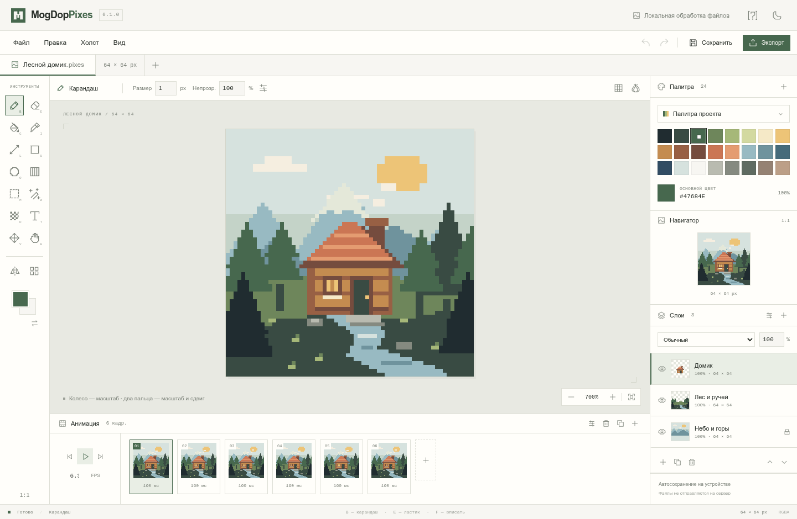

# MogDopPixes

Пиксельный редактор на Rust, TypeScript и Electron. Работает как статическая
веб-страница и как отдельное приложение для компьютера. Лицензия GPL-3.0-only.

- [О программе](https://mogdopteam.ru/pixes)
- [Веб-редактор на MogDopTeam](https://mogdopteam.ru/pixes/editor/)
- [Скачать приложение](https://mogdopteam.ru/pixes-download)
- [Релизы GitHub](https://github.com/Glob876/MogDopPixes/releases)



## Возможности

- Карандаш, ластик, заливка с допуском, пипетка, линии, прямоугольники,
  эллипсы, градиент, дизеринг и растрируемый текст.
- Размер, форма и непрозрачность кисти; нажим пера. Кисти из выделения,
  локальная библиотека из 16 кистей и настраиваемая панель инструментов.
- Прямоугольное выделение, волшебная палочка, копирование, вырезание,
  вставка и перемещение. Вставка изображений из системного буфера.
- Симметрия по X, Y и двум осям, рисование через края, повтор текстуры.
- Слои с видимостью, блокировкой, прозрачностью и режимами наложения.
  Добавление, дублирование, удаление и изменение порядка во всех кадрах.
- Покадровая анимация: собственные ячейки слоёв в каждом кадре, дублирование,
  удаление, порядок, длительность, калька соседних кадров и воспроизведение.
- PNG, JPEG, WebP и GIF: импорт; RGBA Aseprite с обычными слоями: импорт.
  GIF сохраняет покадровую длительность и учитывает правила удаления кадров.
- Экспорт PNG, JPEG, WebP, GIF и спрайт-листов PNG с JSON-описанием кадров.
  Масштаб экспорта целочисленный, без сглаживания.
- Собственный формат `.pixes`, сохраняющий пиксели, все слои, кадры и палитру.
- Палитры до 256 цветов: HEX, RGBA, HSV, импорт PAL/GPL/HEX, экспорт PAL,
  извлечение из изображения и применение к слою; цветокоррекция HSV.
- Масштабирование ближайшим соседом, обрезка/расширение холста, поворот на
  90°, отражения, настраиваемая сетка, миниатюра, референс и фон просмотра.
- История отмены и повтора с ограничением памяти, автосохранение в IndexedDB
  и резервный черновик предыдущего открытого документа.
- Светлая и тёмная темы; телефонный интерфейс и жесты двух пальцев. При
  точном курсоре точка рисования находится на 48 экранных пикселей выше пальца.

## Ограничения версии 0.1

Максимум 2048 px по стороне, 128 слоёв, 512 кадров и 8 млн пикселей суммарно
по всем ячейкам проекта. Эти ограничения сдерживают расход памяти, особенно
на телефоне. История хранит до 60 состояний с бюджетом около 80 МиБ.

Формат Aseprite: 32-битные RGBA, обычные слои с обычным наложением, сжатые,
несжатые и связанные ячейки. Группы, тайловые слои, индексированные цвета и
другие режимы наложения требуют предварительного преобразования в Aseprite.
Экспорт в ASE/PSD/PSP и видео, произвольный RotSprite-поворот, облачная
синхронизация, социальная сеть и скрипты пока отсутствуют. GIF имеет до
256 цветов и однобитную прозрачность; для альфа-канала используйте PNG.

Отмена учитывает изменения всего документа. Сетевой синхронизации нет:
для переноса между устройствами скачайте `.pixes`. Автосохранение не заменяет
файл: очистка данных сайта удаляет локальный черновик и библиотеку кистей.
Браузер должен поддерживать WebAssembly, Canvas 2D, Pointer Events и IndexedDB.

Сопоставление со списком функций Pixel Studio: [docs/FEATURES.md](docs/FEATURES.md).

## Запуск из исходников

Нужны Node.js 24+, Rust stable с `wasm32-unknown-unknown` и wasm-pack 0.15.1.

```sh
rustup target add wasm32-unknown-unknown
cargo install wasm-pack --locked --version 0.15.1
npm ci
npm run build
npm run dev
```

Открыть http://127.0.0.1:4190. Для Electron:

```sh
npm run desktop        # использует уже собранное Rust-ядро
```

Горячее обновление: `npm run dev`, затем во втором терминале
`npm run desktop:dev`. Портретная компоновка включается при ширине до 760 px
или при отношении ширины к высоте не более 4:5.

## Проверки и сборка

```sh
npm test
CARGO_BUILD_JOBS=1 cargo test --locked
npm run build
xvfb-run -a node tests/electron-check.mjs  # Linux: отдельный тестовый профиль
npm run pack:linux                      # AppImage, tar.gz
npm run pack:windows                    # NSIS, portable; на Linux нужен Wine
```

Перед тяжёлыми сборками проверяйте доступную память. Rust-сборка намеренно
запускается с одним заданием. Для сборки Windows предпочтителен Windows runner.

В `dist/` получается статический сайт, пригодный для Cloudflare Pages, в том
числе для подкаталога: URL ассетов относительные. Серверный API не требуется.
Файлы проекта не загружаются на сервер. Веб-страница использует только свои
ассеты; внешняя ссылка на GitHub открывается по действию пользователя.

## Устройство

`crates/pixel-core` содержит Rust-алгоритмы линий, связной заливки, отражения,
поворота, масштабирования и приведения к палитре. Они собираются в WebAssembly
и используются в вебе и Electron. Бинарный модуль встроен в JS, чтобы Electron
мог загружать его без HTTP-сервера. Интерфейс, модель документа, Canvas-композитинг,
история и файловые диалоги написаны на TypeScript.

`electron/main.cjs` — оболочка с изоляцией контекста, sandbox и отключённым Node.js
в рендерере. Файлы сохраняются через механизм загрузок Chromium. Встраивание
на сайт не требует доступа к домашней папке или файлового сервера.

## Лицензии

Код, иконки и демонстрационная иллюстрация проекта — GPL-3.0-only.
Полный текст: [LICENSE](LICENSE). Использованные библиотеки имеют собственные
совместимые лицензии; сведения об Electron/Chromium входят в дистрибутивы.
